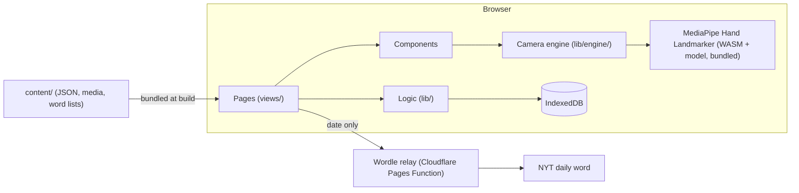

# Handshape Architecture

Nov 10, 2026 · @pie · Describes the app as built on `main`. The original plan (Nov 9) and its
review are in git history and in [architecture-review.md](architecture-review.md).

## Overview

An open-source web app for learning American Sign Language, built as a static site with no
backend: camera processing, sign checking and progress tracking all run in the learner's browser.

- **Goal:** learn ASL fast, starting with fingerspelling and numbers, with live camera feedback.
- **Video never leaves the device.** The camera image is turned into 21 hand points per frame,
  locally, and nothing is recorded unless the learner asks.
- **No accounts.** Progress lives in the browser's IndexedDB, with JSON export and import.
- **One small network call.** Sign Five asks this app's own relay for the day's official Wordle
  word (a date goes out, a word comes back). Everything else works offline once loaded.
- **Content is data.** Lessons, media and word lists are files in `content/`, checked by a
  validator in CI, so contributors can add content without writing code.
- **Every exercise works without the camera.** Learners can always grade themselves; the camera
  check, when there is one, suggests the grade.

## How it fits together



The build bundles the app, the content and the hand-tracking model into static files. The
browser loads them once (the 22 MB hand tracker only when the camera is first turned on), and a
service worker keeps them for offline use.

## Pages

Routing is by URL hash (`#/review`, `#/fingerspelling/read`, …), so any static host works without
redirect rules. Each page is one file in `app/src/views/`, and only `App.svelte` routes to pages.
Every address is defined once in `lib/routes.ts`; pages link with `routes.*`, never a hand-written
`#/…`. Addresses from older versions (`#/learn`, `#/practice`, `#/fingerspell`, `#/progress`) are
redirected there, so old bookmarks keep working.

The main navigation is the same five places on every screen size: Today, Review, Signs, Spelling,
Dashboard. Camera practice belongs with Signs (and is linked from Today and every sign).

| Page | Route | What the learner does |
| --- | --- | --- |
| Today | `#/` | Gets one clear next step, sees streak and signs started, and picks any activity from the Practice hub |
| Review | `#/review`, `#/review/more` | Works through the spaced-repetition queue: new signs, "Read it" (type what a sign means) and "Sign it" (make the sign, camera optional), then grades Again / Hard / Good / Easy. `/more` starts with five extra new signs |
| Signs | `#/signs`, `#/signs/<id>` | Browses every sign: picture, handshape, palm, movement, tips, look-alikes |
| Camera practice | `#/camera`, `#/camera/<id>` | Signs each letter or number to the camera; a sign list shows progress, and the next sign comes on Next (or automatically, if turned on) |
| Fingerspelling | `#/fingerspelling` | Chooses between the two drills and the word game |
| Read | `#/fingerspelling/read` | Sees the reading levels (Letters, Words, Numbers), what's passed and what's next, free practice, and their own mix-ups |
| Reading level | `#/fingerspelling/read/<level>` | Plays ten reads: picks a letter or number from four, or types a word or digit string; then a summary of what was missed |
| Free reading | `#/fingerspelling/read/free` | Watches word after word from the built-in words or a list and types it; speed adapts |
| Spell drill | `#/fingerspelling/spell` | Fingerspells a word; the camera checks each letter and scores the word |
| Sign Five | `#/fingerspelling/sign-five` | Guesses a five-letter word in six tries by fingerspelling it (daily word or practice) |
| About | `#/about` | Reads what the app is and does, how the camera check works, what happens to their data, and what it can't do. Linked from the footer of every page |
| Dashboard | `#/dashboard` | Signs and fingerspelling progress, activity, word lists (`/lists`, `/lists/<id>`), settings and data (`/settings`) |

"Edit list" in a drill remembers the drill for the browser tab, and the lists page offers "Back
to …" until you leave the dashboard.

## Code layout

```
app/src/
  App.svelte            navigation and routing
  app.css               design tokens (colors, radii) and shared classes
  views/                one file per page (table above)
  components/           reusable UI: sign pictures, camera checks, list picker, grade buttons…
  lib/                  logic with no UI
    engine/             camera and hand tracking: no Svelte, tested in Node
```

| Module | Responsibility |
| --- | --- |
| `lib/routes.ts` | Every address, redirects from older ones, page names, and the "Back to …" memory |
| `lib/types.ts` | Shared types and defaults (settings, cards, attempts, word lists, Sign Five save) |
| `lib/db.ts` | IndexedDB store: cards, reviews, attempts, settings; export, import, delete all |
| `lib/settings.svelte.ts` | The one shared copy of settings; `updateSettings(patch)` merges into the latest saved settings and saves in order |
| `lib/lists.ts` | Named word lists: helpers, and migration of settings saved by older versions |
| `lib/content.ts` | Loads `content/` units and media at build time |
| `lib/srs.ts` | FSRS scheduling (ts-fsrs), the review queue and session, wait times in words |
| `lib/stats.ts` | Review stats: card counts, retention, streak, activity, weakest signs |
| `lib/spelling.ts` | Fingerspelling: playback timing, adaptive speed, word picking, `spellingSummary()` |
| `lib/receptive.ts` | Reading practice: the levels, what goes in a session, choices for a letter, scoring, unlocking, and the learner's mix-ups |
| `lib/fingerspell.ts` | What the fingerspelling pages share: letters, showable letters, chosen word list |
| `lib/guess.ts` | Sign Five: scoring guesses, daily word (official or local), saved game |
| `lib/illustrations.ts` | Drawn hand illustrations used when a sign has no image |
| `lib/engine/camera.ts` | Opens the camera, loads the tracker, runs it each frame, draws the hand |
| `lib/engine/landmarker.ts` | MediaPipe Hand Landmarker (loaded on demand, GPU with CPU fallback) |
| `lib/engine/features.ts` | Turns 21 hand points into measurements: finger curl, spread, thumb position, hand and palm direction |
| `lib/engine/handshapes.ts` | One readable rule list per letter and number, each rule with the fix to suggest |
| `lib/engine/tracker.ts` | Smoothing across frames, and "held long enough" timing |
| `lib/engine/modelHand.ts`, `poses.ts` | A model hand built from joint angles, and one pose per sign. Used by the guide and by the tests |
| `lib/engine/guide.ts` | The guide hand: a sign's pose sized to the learner's hand and pinned to their wrist |
| `lib/engine/handAnimation.ts` | The moving hand in reading practice: where the model hand is at any moment while it spells a word |
| `lib/engine/movement.ts` | Letters drawn in the air (J, Z): follows a fingertip, finds the stroke, matches its shape |
| `lib/engine/reader.ts` | Reads *which* letter is being made (for Sign Five): still letters, drawn J/Z and the two command gestures, with safeguards against stray letters |
| `lib/engine/gestures.ts` | The command gestures for typing by camera: thumbs up (enter) and thumbs down (delete) |

Rules that keep this tidy: pages don't import other pages; `lib/` doesn't import components;
`lib/engine/` doesn't import Svelte; colors come from tokens in `app.css`.

## Camera engine

Every camera feature uses the same pipeline:

1. **Camera and tracker** (`camera.ts`, `landmarker.ts`): front camera at 640×480; MediaPipe
   returns 21 points per hand. The learner's signing hand is preferred when two are visible.
2. **Smoothing** (`tracker.ts`): a moving average removes jitter.
3. **Measurements** (`features.ts`): curl per finger, spread, thumb placement, which way the
   hand points and the palm faces, all relative to the hand's own size.
4. **Rules** (`handshapes.ts`): each sign is a list of checks. Each check has a hint, which may
   depend on what was measured, and names the part of the hand it is about. Things the camera
   often can't see (tucked thumbs, P's index pointing at the lens) are marked *unsure*: they show
   as advice but never block a match. A finger can be *extended* (little total bend) or just
   *straight* (its own two joints straight, at any knuckle angle): K and P's middle finger is
   straight but leans far forward, so it is checked as straight.
5. **Judging** (`judge()`): a loose match doesn't count if the hand fully matches a different
   sign, so one fist can't pass for A, E, M, N, S and T alike. Look-alikes are separated by one
   shared test that one sign requires and the other forbids, so no hand can be both: T and X by
   whether the index stands up off the fist (`indexStandsUp`); 2 and 3, and 4 and 5, by whether
   the thumb sticks out to the side (`thumbSticksOut`, which a thumb laid across the palm never
   does); K and C against P by whether the middle finger points at the floor.
6. **Timing:** a target sign counts once held for 0.6 s (`HoldTimer`). Sign Five's open reader
   (`LetterReader`) needs 0.9 s, ignores fast movement, and won't type the same letter again
   until the hand changes or drops, so a long hold types one letter.
7. **Movement** (`movement.ts`), for J and Z: once the starting handshape is held still, the
   drawing fingertip (pinky for J, index for Z) is followed. A stroke starts when the tip moves
   away and ends when it rests; starts and stops are judged by distance, not speed, so jitter
   and slow drawing are both fine. The stroke is resampled, scaled to its own size and compared
   with the letter's shape, plus simple structural rules (a J needs a turn into its hook, a Z
   needs its three strokes) so a plain line or a dropping hand can't pass. A correct shape drawn
   mirrored counts, with a tip. In Sign Five (`CameraTyper`) a drawn J or Z types that letter
   and replaces an I or D typed just before from the same handshape. J and Z start from the
   thumb-tucked hand, so a Y or an L (thumb out) can't start one, and a stroke takes over from
   still letters only once the fingertip's trail is about half a palm length across, so a
   swaying hand still types its letter.
8. **Commands** (`gestures.ts`), in Sign Five: a fist with the thumb held straight and standing
   clear of the rest of the hand is Enter when it points up and Delete when it points down. They
   are held like a letter, take priority over letters, and still work when the row is full.

9. **Showing the fix** (`guide.ts`, `camera.ts`): the finger a hint is about is drawn in the
   "fix" color on the tracked hand. With the Guide on, the sign's model pose is drawn under it
   as a pale hand, scaled by fitting the tracker's 3D points to the picture (so a hand tipped
   toward the camera keeps its size) and pinned to the wrist, with the same finger in the "match" color. A hand shown from
   the back gets fingernails. The camera offers the guide after a sign has failed for 4 s.

10's thumb shake isn't checked yet: only its starting handshape is. All thresholds here are
first estimates on a model hand; `fixtures/handshapes/` holds real recordings to tune them.

## Data and storage

All learner data is in one IndexedDB database (`asl`):

| Store | Holds |
| --- | --- |
| `cards` | One FSRS card per sign and direction (recognize, produce) |
| `reviews` | Every review: grade, time, typed answer, camera match |
| `attempts` | Every fingerspelling attempt: word, mode, correct, speed, replays |
| `settings` | Small records: `settings` (preferences, word lists) and `signFive` (game in progress, stats) |

- **Reading practice** needs no store of its own. Each read is an `attempts` record marked
  `drill: 'word' | 'letter' | 'number'` (absent on older records, meaning a word), and mix-ups are
  worked out from those. Level progress (`readLevels`) and the display choice (`readDisplay`) live
  in settings.
- **Export / import** is one JSON file with all of the above. Import replaces everything; older
  files without newer fields still import.
- **Migrations** happen when settings are read: older one-list settings become named lists, and
  Sign Five data from older versions moves from localStorage into the database once.
- **localStorage** holds only per-device conveniences (Camera page toggles).

## Content

| Path | Holds | Checked by |
| --- | --- | --- |
| `content/units/*.json` | Lesson units: signs, descriptions, tips, look-alikes, media, review status; practice words, some grouped with a hint ("a name") | `schema/unit.schema.json` + `npm run validate` |
| `content/media/` | Public-domain letter and number images | validator (files exist) |
| `content/words/*.json` | Word lists, e.g. the Sign Five dictionary | `schema/wordlist.schema.json` + validator (length, repeats) |

Each unit records whether it has been reviewed by a Deaf signer (`review.status`, `reviewed_by`);
until every unit is reviewed, the About page says the descriptions have not yet been reviewed by a Deaf signer.

## Network and privacy

- No analytics, accounts or uploads. Camera frames are processed and discarded in the browser.
- The only request the app makes is Sign Five's daily word: `GET /api/wordle/<date>.json` to the
  app's own host. In production a Cloudflare Pages Function (`functions/api/wordle/[date].js`)
  fetches the NYT answer and returns only the word; in development the Vite dev server does the
  same. If the relay can't be reached (offline, or a host without functions such as GitHub Pages),
  the game uses its own word of the day.

## Build, test and deploy

| Layer | Choice |
| --- | --- |
| UI | Svelte 5 (runes), Vite 6, installable PWA (vite-plugin-pwa) |
| Tracking | MediaPipe Tasks Vision, Hand Landmarker, WASM and model bundled |
| Scheduling | FSRS via ts-fsrs |
| Storage | IndexedDB via idb |
| Tests | Vitest (logic, engine against synthetic hands, storage with fake-indexeddb), svelte-check |
| CI | GitHub Actions: validate, type check, test and build on every pull request and every push to `main` |
| Hosting | GitHub Pages from `main` (CI deploys it); Cloudflare Pages also works and adds the Wordle relay |

For Cloudflare Pages: build command `npm run build`, output `dist`, `NODE_VERSION=22`.

## Licenses

Code is MIT. Content in `content/` is CC BY 4.0 unless a media entry says otherwise; the letter
and number images are public domain from wpclipart.com, credited on each item. The hand-tracking
model's source and license are listed in `models/README.md`.

## Roadmap

Done:

1. Review spine: FSRS queue, IndexedDB, export and import, self-grading everywhere.
2. Alphabet and numbers 0–10 with public-domain images and drawn hands.
3. Static handshape checks for every letter and number, with fix hints and look-alike detection.
4. Receptive fingerspelling (adaptive speed, WPM) and expressive fingerspelling with per-letter
   camera scoring.
5. Sign Five word game, named word lists, dashboard.
6. Movement checks for J and Z (drawn letters), in target checks and in Sign Five.
7. Guide hand and finger highlight in the camera view; looser, clearer checks for K, P and 1–5.
8. Reading module: levels for letters, words and numbers, mix-up drill, session summaries, and
   an optional moving hand.

Next:

1. **Real recorded samples** in `fixtures/handshapes/` to tune the rules against real hands,
   P, K, 1, 2, 4 and 5 first, then T, X, J and Z (the folder and the Save sample button are set
   up; no samples yet).
2. **Movement check for 10** (thumb shake), and J/Z words as Sign Five answers once tuned.
   **Numbers above 10** (and so years and prices) for reading practice.
3. **First vocabulary unit** (greetings, introductions) with location checks, which need face
   or body landmarks as a reference.
4. **Run tracking in a Web Worker** so the page stays smooth on slower phones.
5. **Deaf review** of the alphabet and numbers units, recorded in `reviewed_by`.
6. Later: facial grammar for questions, and guided conversation practice.
